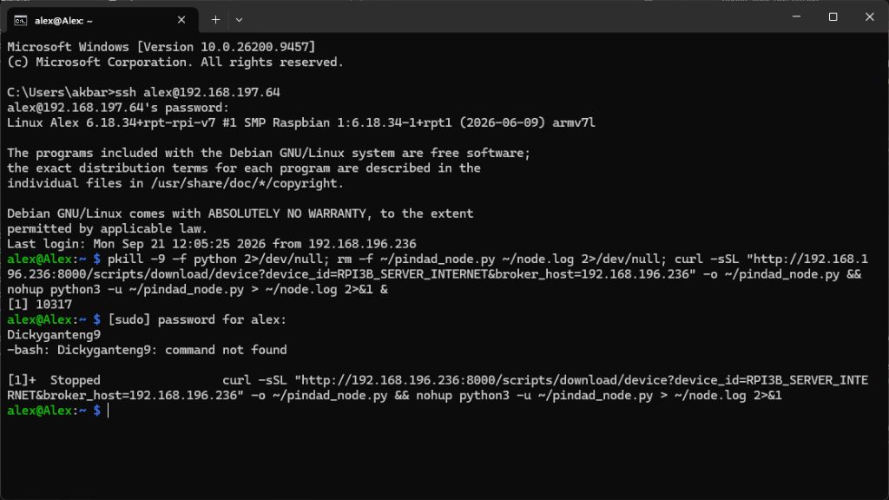

# ❄️ SIKOMAT — Sistem Informasi Kontrol & Monitoring Otomatis AC
### 🏢 PT PINDAD (PERSERO) • Divisi Mutu & Teknologi Informasi

<p align="center">
  
</p>

<p align="center">
  <a href="https://github.com/W2LS/SIKOMAT/releases"></a>
  
  
  
  
  
  
</p>

<p align="center">
  
</p>

---

## 📑 Daftar Isi
1. [Ringkasan Proyek](#-ringkasan-proyek)
2. [Keunggulan & Fitur Utama](#-keunggulan--fitur-utama)
3. [Arsitektur Sistem (Enterprise Multi-Tenancy & Edge IoT)](#-arsitektur-sistem-enterprise-multi-tenancy--edge-iot)
4. [Modul Aplikasi Web SIKOMAT](#-modul-aplikasi-web-sikomat)
5. [Skema Wiring & Pinout Hardware](#-skema-wiring--pinout-hardware)
6. [Panduan Instalasi & Deployment](#-panduan-instalasi--deployment)
   - [Setup Server Web Dashboard](#1-setup-server-web-dashboard-laravel--mqtt)
   - [Setup Node Raspberry Pi Baru (1-Baris Perintah)](#2-setup-raspberry-pi-node-baru-1-baris-perintah)
7. [Protokol Komunikasi MQTT](#-protokol-komunikasi-mqtt)
8. [Struktur Direktori Repositori](#-struktur-direktori-repositori)
9. [Buku Panduan & SOP Teknis Cetak PDF](#-buku-panduan--sop-teknis-cetak-pdf)
10. [Catatan Rilis & Changelog](#-catatan-rilis--changelog)

---

## 📌 Ringkasan Proyek

**SIKOMAT (Sistem Informasi Kontrol & Monitoring Otomatis AC)** adalah platform Industrial Internet of Things (IIoT) yang dikembangkan khusus untuk mengotomasi pergantian shift rotasi, pemantauan beban arus listrik riil presisi tinggi, dan pencegahan *overheating* pada unit pendingin ruangan (AC) server strategis di lingkungan **PT PINDAD (PERSERO)**.

Sistem ini menggabungkan **Edge Computing (Raspberry Pi + Hardware RTC DS3231 + ADC ADS1115 + Sensor ACS712)** dengan **Enterprise Central Dashboard (Laravel 12 + MongoDB + Mosquitto MQTT + WebSocket Broadcast)** untuk menjamin pengawasan fasilitas berjalan tanpa henti (24/7) dengan tingkat keandalan militer (*defense-grade reliability*).

---

## 🚀 Keunggulan & Fitur Utama

- ⚡ **True-RMS Physical Current Sensing (Zero Deadband / Zero Dummy):**
  Menggunakan konversi ADC ADS1115 (16-bit, 860 SPS) dengan perhitungan matematis True-RMS murni tanpa pemotongan batas ambang buatan. Mampu mengukur beban fisik secara transparan mulai dari lampu indikator panel kecil (~15–20 mA) hingga kompresor AC industri berdaya besar.
- ⏰ **Otomasi Shift Perangkat Keras Mandiri (RTC DS3231):**
  Otomasi rotasi AC tetap berjalan tepat waktu meskipun koneksi internet terputus, berkat modul RTC hardware baterai internal. Terintegrasi dengan proteksi *anti-flicker* dan prioritas saklar manual pengguna (*manual override retention*).
- 🔄 **Anti-Mati Mendadak & Stabilitas Saklar:**
  Penambahan atau penghapusan jadwal tidak akan menyebabkan relai terpicu ulang (*klik-klak*) atau saklar web berkedip sendiri. Jika jadwal aktif dihapus dari dashboard, unit AC yang sedang menyala akan tetap beroperasi dalam mode manual.
- 📱 **Peringatan Cerdas Bot Telegram:**
  Notifikasi transisi status dikirim secara instan ke ponsel teknisi ketika AC menyala (*AC MENYALA*) atau mati (*AC MATI*) berbasis keberadaan arus listrik riil.
- 💾 **Store-and-Forward (Buffer Offline SQLite):**
  Jika jaringan server terputus, data telemetri disimpan ke antrean lokal di Raspberry Pi dan secara otomatis dikirim kembali (*drained*) saat koneksi pulih tanpa ada data yang hilang.
- 📋 **Generator Skrip Node Otomatis:**
  Pendaftaran perangkat baru cukup melalui dashboard, skrip agen Python khusus perangkat dapat diunduh langsung atau diinstal otomatis hanya dengan satu baris perintah `curl`.
- 📑 **Dokumen SOP Teknis Cetak PDF A4:**
  Tersedia halaman siap cetak berstandar dokumen kontrol perusahaan lengkap dengan nomor SOP dan lembar pengesahan tanda tangan teknisi.

---

## 🏛️ Arsitektur Sistem (Enterprise Multi-Tenancy & Edge IoT)

```text
  ┌────────────────────────────────────────────────────────────────────────┐
  │                 PT PINDAD (PERSERO) - SIKOMAT CLOUD / ON-PREM          │
  │                                                                        │
  │    ┌──────────────────┐    ┌─────────────────┐    ┌────────────────┐   │
  │    │  Laravel 12 Web  │◄──►│ Mosquitto Broker│◄──►│ MongoDB Atlas  │   │
  │    │ (Dashboard/API)  │    │ (TCP Port 1883) │    │ & SQLite DB    │   │
  │    └────────┬─────────┘    └────────┬────────┘    └────────────────┘   │
  └─────────────┼───────────────────────┼──────────────────────────────────┘
                │ HTTP REST / Sync      │ MQTT Telemetry & Commands
                ▼                       ▼
  ┌────────────────────────────────────────────────────────────────────────┐
  │                 EDGE HARDWARE NODE (Raspberry Pi 3B+)                  │
  │                                                                        │
  │  ┌──────────────────────────────────────────────────────────────────┐  │
  │  │ Python 3 Engine (pindad_universal_node.py)                       │  │
  │  │  - True-RMS Digital Signal Processing (ADS1115 @ 860 SPS)        │  │
  │  │  - Dual-Sync RTC DS3231 Scheduler (WIB GMT+7)                    │  │
  │  │  - Local Store-and-Forward SQLite Buffer Queue                   │  │
  │  └───────────────┬──────────────────────────┬───────────────────────┘  │
  │                  │ I2C Bus                  │ GPIO Digital Out         │
  │                  ▼                          ▼                          │
  │         ┌─────────────────┐        ┌─────────────────┐                 │
  │         │   ADS1115 ADC   │        │ Relay Aktif Low │                 │
  │         │   + RTC DS3231  │        │ (1 s/d 8 Ch)    │                 │
  │         └────────┬────────┘        └────────┬────────┘                 │
  │                  │                          │                          │
  │                  ▼                          ▼                          │
  │         ┌─────────────────┐        ┌─────────────────┐                 │
  │         │ Sensor ACS712   │        │ Lampu Panel /   │                 │
  │         │ (5A / 20A / 30A)│        │ Kontaktor AC    │                 │
  │         └─────────────────┘        └─────────────────┘                 │
  └────────────────────────────────────────────────────────────────────────┘
```

---

## 📱 Modul Aplikasi Web SIKOMAT

| Modul | Deskripsi Fungsi |
| :--- | :--- |
| **1. Home Dashboard** | Pemantauan kartu AC real-time, toggle saklar manual, beban arus (A), daya (Watt), status shift aktif, dan log event. |
| **2. DevZone (Templates)** | Konsol perancangan cetak biru (*blueprint*) hardware, pemetaan Virtual Pin (V0–V127), dan manajemen profil sensor. |
| **3. Log & Audit Trail** | Riwayat telemetri historis, grafik tren konsumsi listrik, filter rentang tanggal, pembersihan log, dan ekspor data ke format CSV. |
| **4. Akun & Sistem** | Pengaturan bot Telegram, manajemen akun staf (Admin, Operator, Teknisi), dan pengunduhan Buku Panduan PDF SOP resmi. |

---

## 📟 Skema Wiring & Pinout Hardware

### 1. Jalur Komunikasi I2C (Sensor ADC ADS1115 & RTC DS3231)
| Komponen Hardware | Pin Modul | Pin Raspberry Pi | Keterangan |
| :--- | :--- | :--- | :--- |
| **Semua Modul I2C** | VCC | Pin 1 / 2 (3.3V / 5.0V) | Catu daya modul sensor |
| **Semua Modul I2C** | GND | Pin 6 / 9 / 14 (GND) | Ground bersama (*common GND*) |
| **ADS1115 & DS3231** | SDA | Pin 3 (GPIO 2 / SDA) | Jalur Data Serial I2C |
| **ADS1115 & DS3231** | SCL | Pin 5 (GPIO 3 / SCL) | Jalur Clock Serial I2C |
| **ACS712 Channel 1** | OUT | ADS1115 Pin A0 | Pembacaan arus AC 1 |
| **ACS712 Channel 2** | OUT | ADS1115 Pin A1 | Pembacaan arus AC 2 |

### 2. Standar Pinout Modul Relay Industri (Active-Low)
| Target Unit AC | Pin GPIO Raspberry Pi | Pin Fisik Board | Default Channel ADC |
| :--- | :--- | :--- | :--- |
| **AC Unit 1** | **GPIO 17** | Pin 11 | ADC 0 (A0) |
| **AC Unit 2** | **GPIO 27** | Pin 13 | ADC 1 (A1) |
| **AC Unit 3** | **GPIO 22** | Pin 15 | ADC 2 (A2) |
| **AC Unit 4** | **GPIO 23** | Pin 16 | ADC 3 (A3) |
| **AC Unit 5** | **GPIO 24** | Pin 18 | ADC 0 (A0) |
| **AC Unit 6** | **GPIO 25** | Pin 22 | ADC 1 (A1) |
| **AC Unit 7** | **GPIO 5**  | Pin 29 | ADC 2 (A2) |
| **AC Unit 8** | **GPIO 6**  | Pin 31 | ADC 3 (A3) |

---

## 💻 Panduan Instalasi & Deployment

### 1. Setup Server Web Dashboard (Laravel & MQTT)

Pastikan lingkungan server telah terpasang **PHP 8.2+**, **Composer**, **Mosquitto MQTT**, dan **MongoDB**.

```bash
# 1. Clone repositori ke server
git clone https://github.com/W2LS/SIKOMAT.git
cd SIKOMAT

# 2. Instal dependensi PHP via Composer
composer install --no-dev --optimize-autoloader

# 3. Konfigurasi Environment
cp .env.example .env
php artisan key:generate

# 4. Migrasi Database & Seeder Awal
php artisan migrate --force
php artisan db:seed --force

# 5. Jalankan Web Server & Listener MQTT
# (Pada server produksi, gunakan Nginx + Supervisor untuk mqtt:subscriber)
php artisan serve --host=0.0.0.0 --port=8000
php artisan mqtt:subscriber
```

---

### 2. Setup Raspberry Pi Node Baru (1-Baris Perintah)

Setup Raspberry Pi baru dapat dilakukan secara instan tanpa perlu menyalin kode secara manual.

#### Langkah A: Instalasi Library Python (Khusus Raspberry Pi Baru - Cukup 1x)
```bash
sudo apt-get update && sudo apt-get install -y python3-pip i2c-tools
pip3 install --break-system-packages paho-mqtt adafruit-circuitpython-ads1x15 adafruit-circuitpython-ds3231 RPi.GPIO
```

#### Langkah B: Unduh Skrip Tailored & Jalankan Otomatis on Boot
Jalankan perintah 1-baris berikut di terminal Raspberry Pi (sesuaikan `device_id` dan IP server):
```bash
curl -sSL "http://192.168.196.236:8000/scripts/download/device?device_id=RPI3B_SERVER_INTERNET&broker_host=192.168.196.236" -o ~/pindad_node.py && (crontab -l 2>/dev/null | grep -v 'pindad_node'; echo "@reboot sleep 10 && python3 -u ~/pindad_node.py > ~/node.log 2>&1 &") | crontab - && nohup python3 -u ~/pindad_node.py > ~/node.log 2>&1 &
```

#### Langkah C: Pantau Log Aktivitas Real-Time
```bash
tail -f ~/node.log
```

---

## 📡 Protokol Komunikasi MQTT

### 1. Topik Telemetri Uplink (Node → Server)
* **Topik:** `pindad/devices/{DEVICE_ID}/telemetry`
* **Format Payload JSON:**
```json
{
  "device_id": "RPI3B_SERVER_INTERNET",
  "active_ac": "AC_1_ON",
  "ac_number": 1,
  "state": "ON",
  "current_ampere": 0.0211,
  "watt": 5,
  "recorded_at": "2026-09-24 08:15:00",
  "turbo_active": false
}
```

### 2. Topik Kontrol Downlink (Server → Node)
* **Topik:** `pindad/devices/{DEVICE_ID}/control`
* **Format Payload JSON:**
```json
{
  "device_id": "RPI3B_SERVER_INTERNET",
  "ac": 1,
  "command": "ON",
  "state": "ON",
  "timestamp": "2026-09-24T08:15:00.000Z"
}
```

### 3. Topik Sinkronisasi Jadwal (Server → Node)
* **Topik:** `pindad/devices/{DEVICE_ID}/schedule`
* **Format Payload JSON:**
```json
{
  "device_id": "RPI3B_SERVER_INTERNET",
  "server_time": "2026-09-24T08:15:00+07:00",
  "schedules": [
    {
      "id": "66f2a89c...",
      "label": "Shift Pagi",
      "start_time": "07:00",
      "end_time": "15:00",
      "target_ac": "all",
      "is_active": true
    }
  ]
}
```

---

## 📁 Struktur Direktori Repositori

```text
SIKOMAT/
├── app/
│   ├── Console/Commands/
│   │   ├── MqttPublisher.php           # Command uji publish MQTT
│   │   └── MqttSubscriber.php          # Worker background penerima telemetri MQTT
│   ├── Http/Controllers/
│   │   ├── AcControlController.php     # Kontrol manual saklar AC & Virtual Pin
│   │   ├── AuthController.php          # Autentikasi sesi staf & RBAC
│   │   ├── DashboardController.php     # Controller utama modul Home & Fleet
│   │   ├── ProfileSettingsController.php # Generator tailored skrip node Python
│   │   ├── ScheduleController.php      # Manajemen jadwal shift & sync MQTT
│   │   └── TelemetryLogController.php  # Riwayat log telemetri & ekspor CSV
│   ├── Models/
│   │   ├── AcLog.php                   # Model log arus & watt telemetri
│   │   ├── Device.php                  # Model data node ruangan (MongoDB)
│   │   ├── Schedule.php                # Model aturan shift kerja RTC
│   │   ├── SystemSetting.php           # Model konfigurasi Telegram & alarm
│   │   └── Template.php                # Model blueprint template hardware
│   └── Services/
│       ├── AnomalyDetectorService.php  # Deteksi status AC Nyala / Mati berbasis arus
│       ├── MqttService.php             # Handler koneksi broker MQTT
│       ├── TelegramService.php         # Service bot alert Telegram
│       └── WebSocketBroadcastService.php # WebSocket real-time broadcast
├── resources/
│   └── views/
│       ├── dashboard.blade.php         # Template antarmuka utama SIKOMAT
│       ├── panduan-pdf.blade.php       # Halaman cetak SOP & Buku Panduan A4
│       └── partials/                   # Komponen modular antarmuka
├── scripts/
│   ├── node_config.json                # Template konfigurasi lokal node
│   ├── pindad_universal_node.py        # Mesin IoT Universal Node (Python)
│   └── setup_raspberry_pi.sh           # Shell script automasi dependensi Linux
├── routes/
│   └── web.php                         # Definisi rute web & API telemetri
├── public/
│   ├── SIKOMAT.png                     # Logo resmi SIKOMAT PT PINDAD
│   └── dashboard_preview.png           # Tangkapan layar antarmuka dashboard
└── README.md                           # Dokumentasi komprehensif proyek
```

---

## 📑 Buku Panduan & SOP Teknis Cetak PDF

SIKOMAT menyediakan dokumen panduan resmi yang dirancang dengan tata letak cetak A4 berstandar PT PINDAD (PERSERO):

* **URL Akses:** `http://localhost:8000/panduan/pdf` (atau klik tombol **`📥 Unduh PDF Manual`** pada Modul 4).
* **Fitur Dokumen:**
  - Nomor SOP Resmi: `SOP/TI-PINDAD/AC/2026/V2.6`.
  - Panduan lengkap 6 BAB (Arsitektur Sistem, Pengoperasian Web, Wiring Hardware 1–8 Channel, Instalasi Node, Peringatan Telegram, dan Prosedur Troubleshooting).
  - Lembar pengesahan tanda tangan teknisi (**Dicky Akbar Syah Putra**) dan pimpinan divisi terkait.
  - Cetak otomatis teroptimasi `@media print` untuk disimpan langsung menjadi file PDF.

---

## 📝 Catatan Rilis & Changelog

### Versi 2.6.0 (September 2026) - *Production Precision & Stability Edition*
- 🎯 **True-RMS Zero-Suppression Sensing:** Penghapusan seluruh filter *deadband/noise floor cut-off*. Beban arus fisik murni ditampilkan apa adanya secara transparan (mendukung lampu panel 15–20 mA hingga kompresor AC besar).
- 🛡️ **Anti-Flicker & Schedule Stability:** Penyempurnaan logika sinkronisasi jadwal MQTT (`force=False`). Penambahan/penghapusan jadwal tidak lagi memicu relai berkedip atau bergerak sendiri.
- 🔒 **Graceful Schedule Deletion:** Menghapus jadwal shift tidak akan mematikan AC yang sedang menyala secara mendadak; status AC dialihkan dengan aman ke kontrol manual.
- 📢 **Refactored Telegram Bot Alerts:** Menggantikan alarm panik dengan notifikasi perubahan status yang bersih: **AC MENYALA** (saat arus mengalir) dan **AC MATI** (saat arus terputus).
- ⚡ **Non-Interactive System Clock Sync:** Penggunaan `sudo -n` untuk sinkronisasi waktu RTC ke sistem Linux agar skrip latar belakang tidak pernah tersuspensi (*SIGTTIN*).
- 🖼️ **GitHub Showcase Polish:** Dokumentasi komprehensif lengkap dengan diagram arsitektur, tabel pinout, panduan satu baris instalasi, dan pratinjau tampilan dashboard.

---

<p align="center">
  <b>Developed with ❤️ for PT PINDAD (PERSERO) • Divisi Mutu & Teknologi Informasi</b><br>
  <i>Sistem Informasi Kontrol & Monitoring Otomatis AC (SIKOMAT) Berbasis Industrial IoT</i>
</p>
